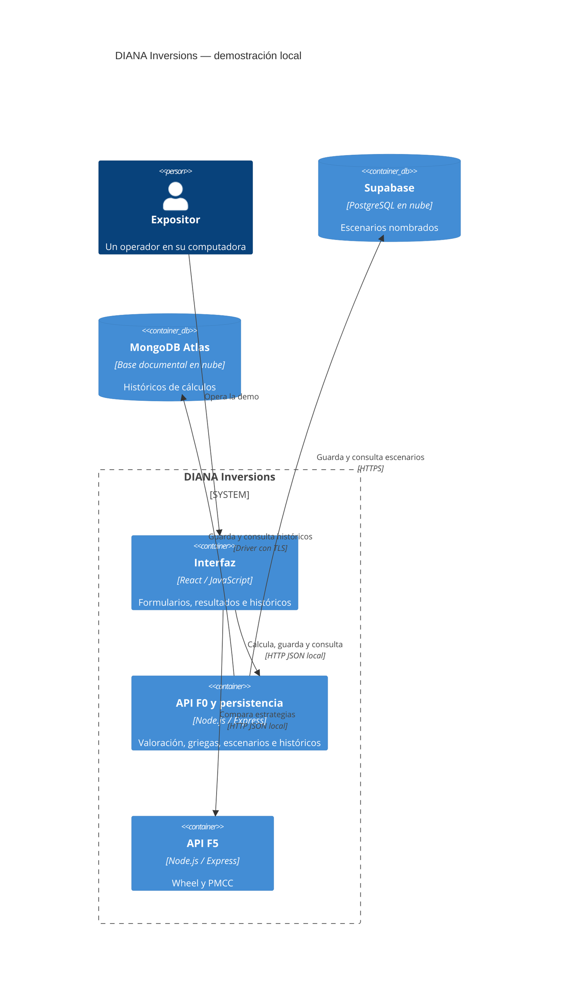

# REPORT-DrFIC — Demo de exposición F0/F5

## Estado y resumen ejecutivo

Tarea 1.1 completada. Implementación: 1 de 10 tareas completadas.
El objetivo es demostrar el recorrido escenario → cálculo → guardado → recuperación
con React, APIs F0/F5 y dos bases en nube. Ya arrancan una pantalla inicial y dos
servidores mínimos; los cálculos y conexiones de nube siguen pendientes. La exposición está prevista para el
9 de noviembre de 2026 según la referencia “mañana” del usuario.

La autorización inicial cubrió documentación. Posteriormente el usuario autorizó
explícitamente implementar la tarea 1.1 e instalar sus dependencias, manteniendo
F0 y F5 separadas. No se ha autorizado aquí continuar las demás tareas, aplicar SQL
ni escribir datos remotos.

## Arquitectura C4 propuesta — nivel de contenedores

Este diagrama describe el destino del diseño. Solo están preparados los contenedores
lógicos locales de React/F0/F5; sus funciones de dominio y enlaces de nube siguen pendientes.

Alpaca y Docker no están implementados ni forman parte de la aceptación de esta
primera demo. Permanecen pendientes académicos, junto con Backspread/Gamma Scalping.

## Lógica prevista

El dominio compartido calculará BSM/griegas y Wheel/PMCC con validaciones comunes.
Calcular no escribirá en nube. Guardar histórico recalculará las entradas en el
backend para no confiar en resultados del navegador. Supabase conservará escenarios;
MongoDB conservará instantáneas de entrada/resultado. UUIDs permitirán repetir una
petición sin duplicar registros. Los fallos de nube serán explícitos.

## Registro de actividades

Las horas siguientes son horas de registro de evidencia; no se atribuyen duraciones
ni ejecuciones a instantes no medidos. Zona: America/Mazatlan, UTC-07:00.

| Registro local | Actividad | Evidencia / resultado |
|---|---|---|
| 2026-11-08 21:07:13 | Inspección de entorno y repositorio | Node v26.10.0, npm 11.19.1, Git 2.55.0.windows.5, OpenSpec 1.16.1; Postman localizado; Docker no localizado en PATH/ubicación habitual |
| 2026-11-08 21:13:04 | Preparación documental | proposal, cuatro specs, design y diez tareas pendientes creados; alcance de exposición incorporado a AGENTS.md/config.yaml |
| 2026-11-08 21:13:04 | Validación OpenSpec | openspec validate demo-exposicion-f0-f5 --strict: valid, código de salida 0 |
| 2026-11-08 21:23:20 | Tarea 1.1 y dependencias | Workspaces y versiones exactas instalados; npm informó 199 paquetes añadidos, 205 auditados y 0 vulnerabilidades conocidas en esa ejecución |
| 2026-11-08 21:23:20 | Rojo del lanzador | Dos pruebas fallaron antes de crear scripts/dev.js: no existía el lanzador requerido |
| 2026-11-08 21:23:20 | Verde y revisión | npm test: 3/3 pasan; arranque/cierre, puerto ocupado sin matar dueño, React/jsdom. npm run build: correcto |
| 2026-11-08 21:23:20 | Protección de entorno | git check-ignore confirmó .env y apps/web/.env.local ignorados; .env.example permanece visible para Git; no se creó .env con secretos |

## Evidencias y límites

| Comprobación | Estado |
|---|---|
| OpenSpec list/context | Raíz del repositorio resuelta; inventario principal de specs vacío |
| OpenSpec status del nuevo cambio | Cuatro artefactos de planificación completos; no significa implementación terminada |
| Validación estricta de deltas | Aprobada |
| Pruebas de preparación | 3/3 pasan; comprobaciones HTTP de servidores mínimos y renderizado React |
| Pruebas financieras y de persistencia | Pendientes de las tareas siguientes |
| Build y arranque | Build React correcto; tres procesos iniciados y cerrados en prueba integrada; puertos liberados |
| Tabla Supabase / colección MongoDB | No creadas por el agente ni comprobadas |
| Credenciales | No solicitadas por chat, no registradas ni probadas |
| Prueba de persistencia tras reiniciar | Pendiente; requisito para afirmar que la demo completa funciona |
| Docker / Alpaca / diez operaciones académicas | Pendientes fuera de este cambio inicial |

## Riesgos de integración por etapa

- Dominio: errores numéricos plausibles. Mitigación prevista: referencias independientes y pruebas de propiedades.
- APIs/interfaz: respuestas antiguas o unidades confusas. Mitigación prevista: contratos, cancelación y etiquetas.
- Nube: recursos, permisos, tabla, IP e Internet aún no verificados. Mitigación prevista: diagnóstico sin secretos y ensayo real autorizado.
- Exposición: plazo corto. Mitigación prevista: priorizar recorrido verificable sin declarar completos entregables posteriores.
- Seguridad: demo sin login. Mitigación prevista: APIs en loopback y secretos exclusivos del backend.

## Próxima revisión

Solicitar aprobación de la tarea 2.1 antes de implementar cálculos.
La plantilla .env.example, exclusión de Git y docs/SETUP.md ya están preparadas.
Solicitar autorización específica antes de aplicar la migración y crear registros
de prueba en los recursos de nube.

## Detalles de ejecución de la tarea 1.1

La instalación inicial encontró ENOTCACHED en el entorno restringido; la descarga
autorizada desde npm completó la instalación. Vite no pudo crear procesos dentro
del sandbox (EPERM); las pruebas y el build se ejecutaron con autorización fuera
de esa restricción. Esos fallos de entorno no cuentan como evidencia roja de TDD.

Se añadieron scripts/dev.js, scripts/web.js y scripts/serve-api.js. El lanzador
comprueba puertos antes de arrancar y usa IPC para cerrar únicamente sus procesos
hijos. Las pruebas del lanzador se escribieron antes de implementarlo; después se
mejoró la limpieza del test y el mensaje de error. La prueba React comprueba la
configuración de herramientas; no representa TDD de una funcionalidad financiera.

Versiones exactas y comandos están en docs/SETUP.md y package-lock.json.
No se modificaron las tareas 2.1–5.1 ni el cambio motor-elegibilidad-empresas.
