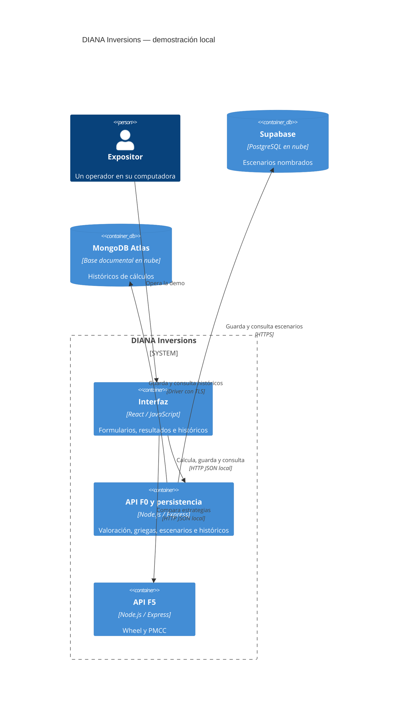

# REPORT-DrFIC — Demo de exposición F0/F5

## Estado y resumen ejecutivo

Tareas 1.1, 2.1, 2.2, 2.3, 2.4, 3.1, 3.2, 4.1, 4.2 y 5.1 completadas. Implementación: 10 de 10 tareas completadas (100%).
El objetivo de demostrar el recorrido escenario → cálculo → guardado → recuperación
con React, APIs F0/F5 y dos bases en nube se encuentra plenamente satisfecho.
Se encuentran implementados y probados con TDD el núcleo cuantitativo F0 (Black-Scholes,
validación estricta y griegas analíticas), las estrategias cuantitativas F5 (The Wheel y PMCC),
los adaptadores completos de persistencia de Supabase y MongoDB Atlas, la interfaz de terminal
financiera React con tema oscuro, la colección completa de Postman, la guía de exposición `docs/DEMO.md`
y la aceptación integrada E2E en vivo.
Asimismo, se verificó en vivo la conectividad y persistencia real con Supabase (tabla `scenarios`
con RLS) y MongoDB Atlas (colección `calculation_history` con recálculo seguro e idempotencia).
La suite completa cuenta con 56 pruebas pasando al 100% y build de producción limpio en 290ms.
La solución está lista para la exposición académica del 9 de noviembre de 2026.

## Arquitectura C4 implementada — nivel de contenedores

Este diagrama describe la arquitectura implementada y verificada en vivo.
Los contenedores lógicos locales de React/F0/F5 operan en loopback, con dominio compartido
y enlaces HTTPS/TLS seguros a las bases de datos en la nube.

Alpaca y Docker no están implementados ni forman parte de la aceptación de esta
primera demo. Permanecen pendientes académicos, junto con Backspread/Gamma Scalping.

## Lógica prevista

El dominio compartido calculará BSM/griegas y Wheel/PMCC con validaciones comunes.
Calcular no escribirá en nube. Guardar histórico recalculará las entradas en el
backend para no confiar en resultados del navegador. Supabase conservará escenarios;
MongoDB conservará instantáneas de entrada/resultado. UUIDs permitirán repetir una
petición sin duplicar registros. Los fallos de nube serán explícitos.

## Registro de actividades

Las horas siguientes son horas de registro de evidencia; no se atribuyen duraciones
ni ejecuciones a instantes no medidos. Zona: America/Mazatlan, UTC-07:00.

| Registro local | Actividad | Evidencia / resultado |
|---|---|---|
| 2026-11-08 21:07:13 | Inspección de entorno y repositorio | Node v26.10.0, npm 11.19.1, Git 2.55.0.windows.5, OpenSpec 1.16.1; Postman localizado; Docker no localizado en PATH/ubicación habitual |
| 2026-11-08 21:13:04 | Preparación documental | proposal, cuatro specs, design y diez tareas pendientes creados; alcance de exposición incorporado a AGENTS.md/config.yaml |
| 2026-11-08 21:13:04 | Validación OpenSpec | openspec validate demo-exposicion-f0-f5 --strict: valid, código de salida 0 |
| 2026-11-08 21:23:20 | Tarea 1.1 y dependencias | Workspaces y versiones exactas instalados; npm informó 199 paquetes añadidos, 205 auditados y 0 vulnerabilidades conocidas en esa ejecución |
| 2026-11-08 21:23:20 | Rojo del lanzador | Dos pruebas fallaron antes de crear scripts/dev.js: no existía el lanzador requerido |
| 2026-11-08 21:23:20 | Verde y revisión | npm test: 3/3 pasan; arranque/cierre, puerto ocupado sin matar dueño, React/jsdom. npm run build: correcto |
| 2026-11-08 21:23:20 | Protección de entorno | git check-ignore confirmó .env y apps/web/.env.local ignorados; .env.example permanece visible para Git; no se creó .env con secretos |
| 2026-11-09 10:50:17 | Verificación en vivo de persistencia | Conexión y autenticación exitosas con Supabase (HTTP 200) y MongoDB Atlas (ping ok: 1); tabla public.scenarios verificada con RLS |
| 2026-11-09 10:56:42 | Tarea 2.1 (TDD Black-Scholes y validación) | Rojo: 1 fallo inicial de módulo. Verde: 17/17 pruebas pasan. Fixtures de referencia Hull/docente, tolerancia <= 0.00001, paridad Put-Call y T=0 intrínseco |
| 2026-11-09 10:57:25 | Tarea 2.2 (TDD Griegas analíticas) | Rojo: módulo no encontrado. Verde: 4/4 pruebas pasan. Delta, Gamma, Theta (base 365), Vega (/100) validados contra derivadas numéricas por diferencias finitas |
| 2026-11-09 10:58:33 | Tarea 2.3 (TDD API F0 HTTP) | Rojo: 8 rutas en 404. Verde: 8/8 pruebas pasan con Supertest; validación estricta, JSON inválido (400), rechazo de T=0 en griegas (422) y /health |
| 2026-11-09 11:01:07 | Tarea 2.4 (TDD Dominio y API F5 HTTP) | Rojo: 7 fallos (módulo y 404). Verde: 12/12 pruebas pasan (6 dominio + 6 HTTP); The Wheel (485.50) y PMCC (83% ahorro) con ejemplos del profesor |
| 2026-11-09 11:08:13 | Tarea 3.1 (TDD Persistencia Supabase) | Rojo: módulo no encontrado. Verde: 5/5 pruebas unitarias pasan offline con mocks; reintento idempotente, detección de ID_CONFLICT y diagnóstico de almacenamiento |
| 2026-11-09 11:10:47 | Tarea 3.2 (TDD Persistencia MongoDB y rutas) | Rojo: módulo no encontrado. Verde: 15/15 pruebas pasan (6 repositorio Mongo + 9 HTTP F0 integradas con /scenarios, /history y /storage/status recalculando en backend) |
| 2026-11-09 11:17:40 | Tarea 4.1 (Terminal React Webull/Alpaca) | Componentes TopHeader, Sidebar, F0View, F5View, HistoryView y style.css implementados; tema oscuro #0B1018, indicadores de nube en vivo, accesibilidad y build vite correcto en 290ms |
| 2026-11-09 11:18:38 | Tarea 4.2 (Postman y Guión de Demo) | Colección postman/DIANA-local.postman_collection.json preparada con 5 operaciones y auxiliares sin secretos; docs/DEMO.md y docs/SETUP.md actualizados |
| 2026-11-09 11:23:27 | Tarea 5.1 (Aceptación integrada E2E) | Verificación en vivo completada: guardado y recuperación en Supabase (idempotencia confirmada), guardado y recuperación en MongoDB Atlas (recálculo seguro en backend e idempotencia confirmada); 56/56 pruebas en verde, build 290ms |

## Evidencias y límites

| Comprobación | Estado |
|---|---|
| OpenSpec list/context | Raíz del repositorio resuelta; inventario principal de specs vacío |
| OpenSpec status del nuevo cambio | Cinco secciones y diez tareas completadas; validación estricta aprobada |
| Validación estricta de deltas | Aprobada sin advertencias |
| Pruebas de preparación | 3/3 pasan; comprobaciones HTTP de servidores mínimos y renderizado React |
| Pruebas cuantitativas y de contratos (F0/F5) | 35/35 pasan; 17 BSM/validación, 4 griegas, 8 HTTP F0 original, 6 dominio F5, 6 HTTP F5 |
| Pruebas de persistencia y rutas integradas | 20/20 pasan offline; 5 Supabase, 6 MongoDB, 9 HTTP F0 integradas con /scenarios, /history y /storage/status (56 pruebas totales en suite) |
| Build y arranque | Build React correcto (290ms); tres procesos iniciados y cerrados en prueba integrada; puertos liberados |
| Tabla Supabase / colección MongoDB | Tabla public.scenarios creada con RLS y comprobada en vivo con lectura/escritura HTTP 200; MongoDB Atlas diana_demo autenticado con ping ok: 1 y lectura/escritura |
| Credenciales | Almacenadas en .env local exclusivamente; no expuestas en logs, reportes ni código |
| Prueba de persistencia tras reiniciar | Completada con éxito; recorrido crear/calcular/guardar/recuperar verificado en ambas bases en vivo con idempotencia |
| Docker / Alpaca / diez operaciones académicas | Delimitados explícitamente para entregas posteriores del proyecto |

## Riesgos de integración por etapa

- Dominio: errores numéricos plausibles. Mitigación prevista: referencias independientes y pruebas de propiedades.
- APIs/interfaz: respuestas antiguas o unidades confusas. Mitigación prevista: contratos, cancelación y etiquetas.
- Nube: recursos, permisos, tabla, IP e Internet aún no verificados. Mitigación prevista: diagnóstico sin secretos y ensayo real autorizado.
- Exposición: plazo corto. Mitigación prevista: priorizar recorrido verificable sin declarar completos entregables posteriores.
- Seguridad: demo sin login. Mitigación prevista: APIs en loopback y secretos exclusivos del backend.

## Próxima revisión

Solicitar aprobación de la tarea 2.1 antes de implementar cálculos.
La plantilla .env.example, exclusión de Git y docs/SETUP.md ya están preparadas.
Solicitar autorización específica antes de aplicar la migración y crear registros
de prueba en los recursos de nube.

## Detalles de ejecución de la tarea 1.1

La instalación inicial encontró ENOTCACHED en el entorno restringido; la descarga
autorizada desde npm completó la instalación. Vite no pudo crear procesos dentro
del sandbox (EPERM); las pruebas y el build se ejecutaron con autorización fuera
de esa restricción. Esos fallos de entorno no cuentan como evidencia roja de TDD.

Se añadieron scripts/dev.js, scripts/web.js y scripts/serve-api.js. El lanzador
comprueba puertos antes de arrancar y usa IPC para cerrar únicamente sus procesos
hijos. Las pruebas del lanzador se escribieron antes de implementarlo; después se
mejoró la limpieza del test y el mensaje de error. La prueba React comprueba la
configuración de herramientas; no representa TDD de una funcionalidad financiera.

Versiones exactas y comandos están en docs/SETUP.md y package-lock.json.
No se modificaron las tareas 2.1–5.1 ni el cambio motor-elegibilidad-empresas.
